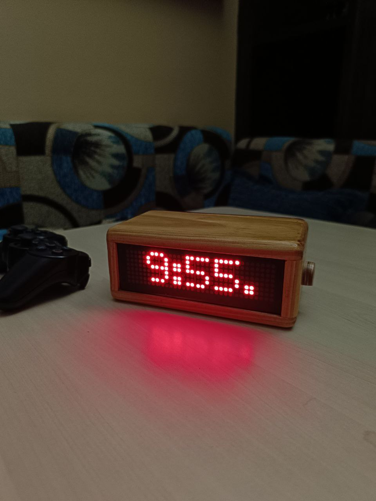

# 🚀 ESP32 LED Matrix Smart Dashboard

A professional, feature-rich IoT dashboard built on ESP32 that integrates Time, Weather, Prayer Times, and Telegram control into a sleek 8x32 LED Matrix.



## 🌟 Key Features

*   **Dynamic Display**: Rotates between Time, Date (with Weather), and custom Telegram messages.
*   **Interactive Telegram Control**: Full "Control Panel" via Telegram Inline Keyboards. No need to type commands—just tap buttons!
*   **Live Weather Integration**: Real-time temperature and weather glyphs (☀️, ☁️, 🌧️, 🌙) for Damascus (Open-Meteo API).
*   **Automated Prayer Times (Azan)**: Fetches daily timings via Aladhan API with automatic audio support (Athan) using a DFPlayer Mini.
*   **Remote OTA Updates**: Update the device firmware anywhere in the world by sending a `.bin` file directly to the Telegram bot.
*   **Local Menu System**: Full on-device configuration using a Rotary Encoder.
*   **Smart Connectivity**: Automatic WiFi configuration portal (Captive Portal) and robust internet recovery logic.
*   **Watchdog Protected**: Industrial-grade safety logic that prevents freezes and ensures 24/7 uptime.

---

## 🛠 Hardware Requirements

| Component | Description |
| :--- | :--- |
| **ESP32 DevKit V1** | The brain of the project. |
| **MAX7219 LED Matrix** | 4-in-1 Module (8x32 pixels), FC-16 Hardware type. |
| **DS3231 RTC Module** | High-precision Real-Time Clock with battery backup. |
| **Rotary Encoder** | EC11 with push-button for local menu navigation. |
| **DFPlayer Mini** | MP3 module for Azan and Alarm audio. |
| **8 Ohm Speaker** | Small speaker for audio output. |
| **Micro SD Card** | For storing MP3 files for the DFPlayer. |

---

## 🔌 Wiring & Pinout

### 1. LED Matrix (SPI)
| ESP32 Pin | Matrix Pin |
| :--- | :--- |
| **5V / VCC** | VCC |
| **GND** | GND |
| **GPIO 23 (MOSI)** | DIN |
| **GPIO 18 (SCK)** | CLK |
| **GPIO 5 (CS)** | CS |

### 2. DS3231 RTC (I2C)
| ESP32 Pin | RTC Pin |
| :--- | :--- |
| **3.3V** | VCC |
| **GND** | GND |
| **GPIO 21 (SDA)** | SDA |
| **GPIO 22 (SCL)** | SCL |

### 3. Rotary Encoder
| ESP32 Pin | Encoder Pin |
| :--- | :--- |
| **GPIO 33** | Output A (CLK) |
| **GPIO 25** | Output B (DT) |
| **GPIO 32** | Push Button (SW) |
| **GND** | GND |

### 4. DFPlayer Mini (Serial2)
| ESP32 Pin | DFPlayer Pin |
| :--- | :--- |
| **5V / VCC** | VCC (Pin 1) |
| **GND** | GND (Pin 7) |
| **GPIO 17 (TX2)** | RX (Pin 2) - *Use 1k resistor if noisy* |
| **GPIO 16 (RX2)** | TX (Pin 3) |

---

## 💻 Software Setup

### 1. Requirements
*   **PlatformIO** (VS Code Extension recommended).
*   **Micro SD Card**: Format as FAT32. Create a folder named `01` and put your Azan/Alarm MP3s inside.

### 2. Library Dependencies
The project automatically manages dependencies via `platformio.ini`:
*   `MD_Parola` & `MD_MAX72XX` (Display)
*   `AsyncTelegram2` (Bot API)
*   `ArduinoJson` v6.21+ (Data Parsing)
*   `IotWebConf` (WiFi Config)
*   `RTClib` (RTC Control)
*   `DFRobotDFPlayerMini` (Audio)

### 3. Telegram Bot Configuration
The bot token and your chat ID are **not stored in the code**. You enter them in the device's config page:
1. Message [@BotFather](https://t.me/botfather), create a bot, and copy its **API Token**.
2. Message [@IDBot](https://t.me/myidbot) to get your personal **Chat ID**.
3. Flash the firmware, join the device's WiFi (see *Initial WiFi Setup* below) and fill in **Bot token** and **Owner chat ID** on the same page as the WiFi settings. Leave the token field empty later to keep the saved one.

The owner can add other users with `add,<chat id>`. Only the owner can add or remove users and update the firmware.

---

## 📲 Usage

### Initial WiFi Setup
1. On first boot the matrix scrolls the setup instructions: the device's own hotspot name (`LedMatrix-XXXX`) and its **setup password**. The password is random, different for every device, and also printed on the serial monitor.
2. Join that hotspot from your phone. A setup page opens (or go to `192.168.4.1`).
3. Enter your home WiFi, choose **your own hotspot password** (this is also the password for the config page later, user `admin`), and fill in the Telegram **bot token** and **owner chat ID**.
4. Save. The device restarts and connects. To change anything later, open `http://<device name or IP>/config`.

**Forgot the hotspot password you chose?** Hold the encoder button while you plug the device in. It starts the setup hotspot again with its own setup password, which the matrix scrolls (and the serial monitor prints). Your saved settings stay until you change them.

### Telegram Dashboard
Send `/start` to your bot to open the **Live Dashboard**.
*   **📝 Msg**: Send a text message to scroll it on the matrix.
*   **🔔 Ring**: Test the alarm speaker.
*   **🕒 Time**: Interactive menu to set system time.
*   **🔊 Vol**: Quick volume presets.
*   **⏰ Set**: Interactive menu to adjust hours, minutes, and AM/PM for the alarm.
*   **⏰ ON/OFF**: Instant toggle for the alarm.
*   **🕋 Azan**: Toggle the automated prayer call.
*   **🌤 Weather**: Manually force a refresh of the weather data.

### Local Control (Rotary Encoder)
The device features a complete on-device menu system for offline configuration.
1.  **Enter Menu**: Long-press the encoder button for 1 second.
2.  **Navigate**: Rotate the knob to cycle through the options below.
3.  **Select**: Long-press to enter a sub-menu or confirm a setting.

**Available Local Menus:**
*   `Time`: Set Hour, AM/PM, Minute, Day, Month, and Year.
*   `Alarm`: Set Alarm Hour, AM/PM, and Minute.
*   `Bright`: Adjust LED intensity (1-8).
*   `AlStat`: Toggle Alarm status (ON/OFF).
*   `Volume`: Adjust speaker volume (0-30).
*   `Music`: Cycle through and preview alarm sounds on the SD card.
*   `PrStat`: Toggle Prayer/Azan status (ON/OFF).
*   `Exit`: Return to the main display.

### Remote OTA Update
Only the owner can do this.
1. Build your project (`pio run`) and compute the checksum of `.pio/build/esp32dev/firmware.bin`: `sha256sum firmware.bin`.
2. Send the `.bin` to the bot as a **Document**.
3. Send `update <sha256>` with the checksum from step 1. The device refuses the file if the checksum differs.
4. The matrix scrolls **"UPDATING..."** and the device restarts. The bot then tells you how the update ended.
5. The new firmware is on trial for 2 minutes. If it crashes or loses power in that time, the device goes back to the previous firmware by itself.

Tagged releases (`v*`) on GitHub publish `firmware.bin` together with its `firmware.bin.sha256`.

> The partition layout in `platformio.ini` (two 1.875 MB firmware slots) only takes effect after **one wired upload** (`pio run -t upload`); saved settings are kept.

---

## 📂 Project Structure

| Folder | What it does |
| :--- | :--- |
| `src/settings/` | Every saved setting (alarm, volume, brightness, ...). One struct, thread-safe getters and validated setters. |
| `src/telegram/` | `telegram.cpp` (bot task, who may talk to it), `commands.cpp` (text commands), `menus.cpp` (inline keyboards), `ota.cpp` (firmware update). |
| `src/display/` | `display.cpp` (render loop) and `pages.cpp` (the screens that rotate: message, date). |
| `src/time/`, `src/rtcClock/` | Clock text and alarm; locked access to the RTC chip. |
| `src/prayerTime/`, `src/weather/` | Aladhan and Open-Meteo fetchers. |
| `src/encoder/` | The local menu. |
| `src/health/` | Memory and stack logging, safe restarts, firmware rollback confirmation. |
| `src/wifi/` | WiFi portal and the Telegram fields in it. |
| `src/shared/`, `src/textUtils/` | Small helpers. |
| `test/` | Unit tests that run on the PC. |

---

## 🧪 Development

```bash
pio test -e native     # unit tests on the PC (with AddressSanitizer), no hardware needed
pio run                # build the firmware
pio run -t upload      # flash over USB
pio device monitor     # serial log
```

GitHub Actions runs the tests and the build on every push and pull request.

**Adding a feature**
- *A Telegram command:* write a handler in `src/telegram/commands.cpp` and add a line to `COMMANDS`.
- *A Telegram button:* add a handler in `src/telegram/menus.cpp` and a line to `CALLBACKS`.
- *A rotating screen:* write a show function in `src/display/pages.cpp` and add a line to `PAGES`.
- *A saved setting:* add a field to `Settings` and a setter in `src/settings/`.
- *A background task:* write the task function and add a line to `TASKS` in `src/main.cpp`.

**Reading the serial log**
The `Health:` lines show free memory, the largest free block and, every 5 minutes, the lowest free stack of each task. The first lines after boot say why the device last restarted. Memory that keeps shrinking means a leak; a stack that gets close to 0 needs a bigger size in `TASKS`.

---

## 📜 License
This project is open-source. Feel free to modify and share!
